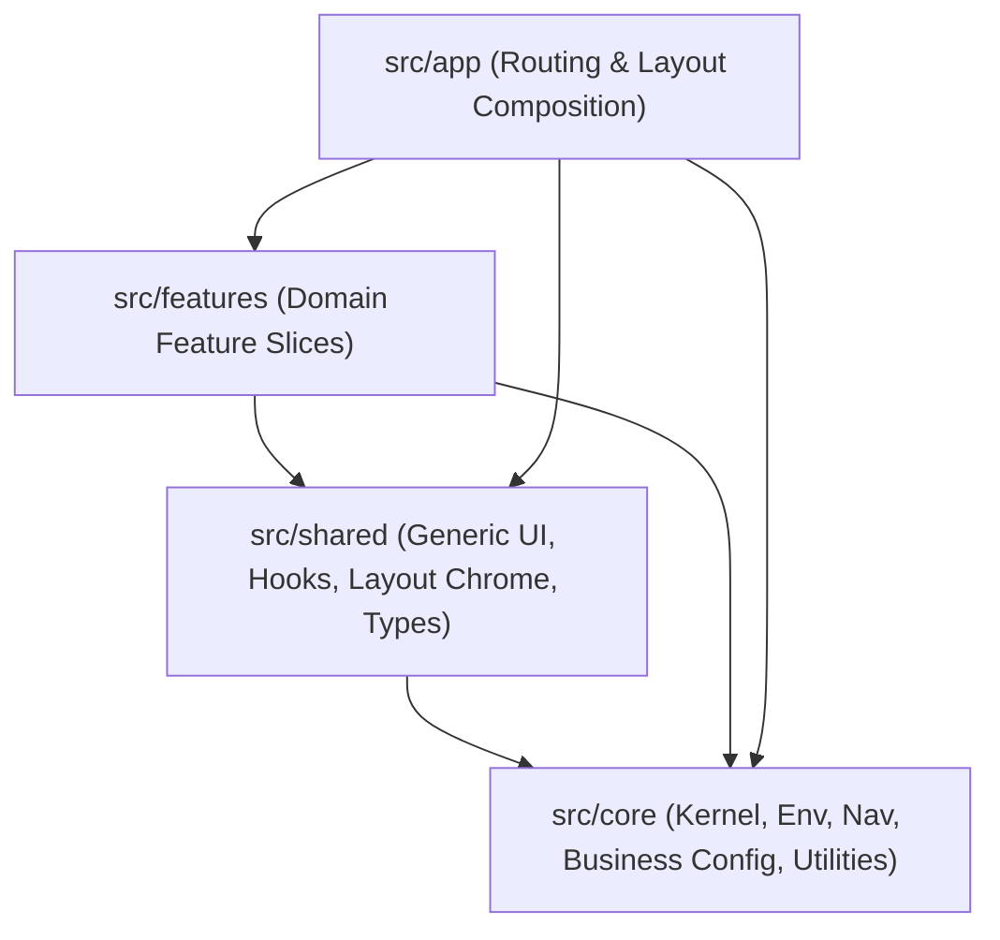

# Hotel Sitara Residency — Official Website

Modern, high-performance static website for **Hotel Sitara Residency** (Kalamboli, Navi Mumbai), built with **Next.js 16 (App Router)**, **React 19**, **TypeScript**, and **Tailwind CSS v4**.

---

## 🏛️ System Design & Architecture

The codebase adheres strictly to a **Layered, Feature-Sliced System Design**. Dependencies point **strictly inward**:

$$\text{app} \longrightarrow \text{features} \longrightarrow \text{shared} \longrightarrow \text{core}$$

A lower layer never imports from a higher layer. This guarantees modularity, maintainability, and clean separation of concerns.



### Core Architectural Layers

1. **`src/app/` — Routing & Pages**
   - Pure composition layer for Next.js App Router (`page.tsx`, `layout.tsx`, `error.tsx`, `not-found.tsx`, `sitemap.ts`, `robots.ts`).
   - Contains zero domain business logic and zero arbitrary styling.

2. **`src/features/` — Domain Slices**
   - Isolated domain packages: `rooms`, `booking`, `home`, `dining`, `blog`, `things-to-do`, `contact`, `gallery`, `search`, and `common`.
   - Each slice encapsulates its own UI components (`components/`), static data (`data/`), and model/API layers.
   - Cross-feature access is strictly routed through feature barrels (`@/features/<slice>`).

3. **`src/shared/` — Cross-cutting Primitives**
   - Reusable presentation components with no domain knowledge:
     - `ui/`: Buttons, Cards, InfoTiles, ImageCallouts.
     - `layout/`: Global Header, Footer, Mobile Drawer, Cookie Panel.
     - `hooks/`: `use-scrolled`, `use-scroll-lock`, `use-escape-key`.
     - `types/`: Domain contracts and shared TypeScript interfaces.

4. **`src/core/` — Kernel**
   - Domain-free bedrock:
     - `config/`: Brand identity (`business.ts`), validated runtime env (`env.ts`), booking engine configuration (`hotelmate.ts`).
     - `constants/`: Canonical routes (`routes.ts`), navigation tree (`nav.ts`).
     - `lib/`: Pure utilities (`cn`, formatting helpers).

---

## 📁 File Structure

```text
sitararesidency/
├── public/                  # Static assets (Optimized .avif images, icons, logos, videos)
│   ├── EXECUTIVE FAMILY SUITE/
│   ├── EXECUTIVE TRIPLE ROOM/
│   ├── images/
│   └── videos/
├── src/
│   ├── app/                 # Next.js App Router (28 static export routes)
│   │   ├── bedrooms/        # Room catalog & dynamic detail pages ([slug])
│   │   ├── blog/            # Blog index & post pages ([slug])
│   │   ├── contact/         # Contact & inquiry page
│   │   ├── dining/          # Dining experiences & venues ([slug])
│   │   ├── gallery/         # Hotel photo gallery
│   │   ├── kids/            # Family stay guide
│   │   ├── leisure/         # Amenities & leisure guide
│   │   ├── location/        # Directions & landmarks
│   │   ├── manage-booking/  # Reservation lookup & portal
│   │   ├── search/          # Amenity & room search
│   │   ├── things-to-do/    # Local attractions & activities
│   │   ├── layout.tsx       # Root layout with font optimization & metadata
│   │   ├── page.tsx         # Homepage
│   │   ├── robots.ts        # Dynamic robots.txt
│   │   └── sitemap.ts       # Dynamic sitemap.xml
│   ├── core/                # Business config, route constants, pure utils
│   ├── features/            # Feature-sliced domain modules
│   ├── shared/              # Shared UI components, layout chrome, custom hooks
│   └── styles/              # Modular CSS layers (Tailwind v4 tokens & components)
│       ├── globals.css      # CSS entry point
│       ├── tokens.css       # @theme design tokens
│       ├── base.css         # Typography, reset & utilities
│       └── sections/        # Section-specific styles (nav, home, rooms, etc.)
├── ARCHITECTURE.md          # Architectural RFC and layer rules documentation
├── eslint.config.mjs        # Flat ESLint 9 configuration
├── next.config.ts           # Next.js static export & image domains configuration
├── package.json             # Scripts & dependencies
├── tsconfig.json            # Strict TypeScript compiler options & path aliases
└── README.md                # Project documentation
```

---

## 🚀 Getting Started

### Prerequisites
- **Node.js**: `v20.x` or `v22.x` (LTS recommended)
- **npm** or **pnpm**

### Installation
```bash
npm install
```

### Development
Start the local development server:
```bash
npm run dev
```
Open [http://localhost:3000](http://localhost:3000) in your browser.

### Type Check & Lint
Ensure code quality and strict type safety:
```bash
npm run typecheck
npm run lint
```

### Production Build & Static Export
Compile and export 100% static HTML/CSS/JS into the `out/` directory:
```bash
npm run build
```
*(On Windows or environments where webpack is preferred for PostCSS: `npm run build:webpack`)*

---

## 🌐 Deployment

Because this project uses Next.js static HTML export (`output: 'export'`), the generated `out/` directory can be deployed to any static host with **zero server maintenance**:

- **Vercel**: Push to GitHub and import the repo. Vercel automatically detects Next.js.
- **GitHub Pages**: Deploy the `out/` folder using the included GitHub Actions workflow.
- **Cloudflare Pages / Netlify**: Point build command to `npm run build` and output directory to `out`.

---

## 🛡️ License & Credits

© Hotel Sitara Residency. All rights reserved.
